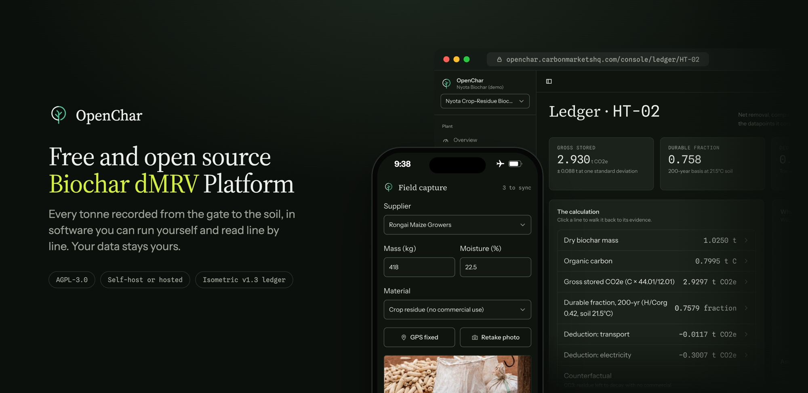
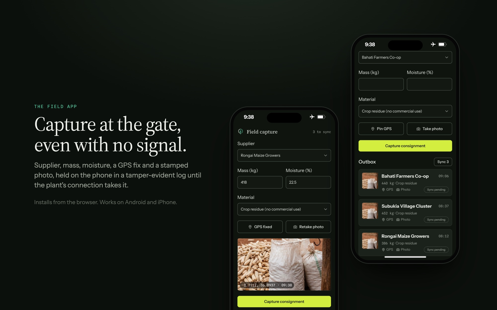
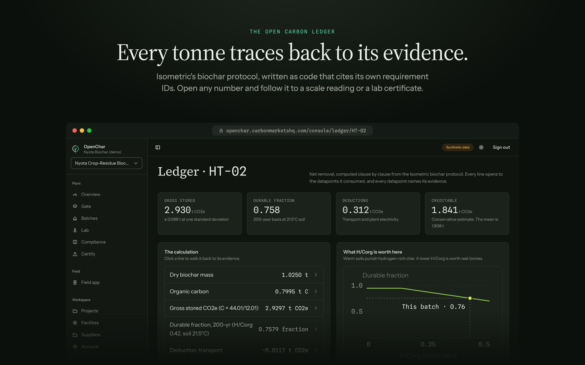
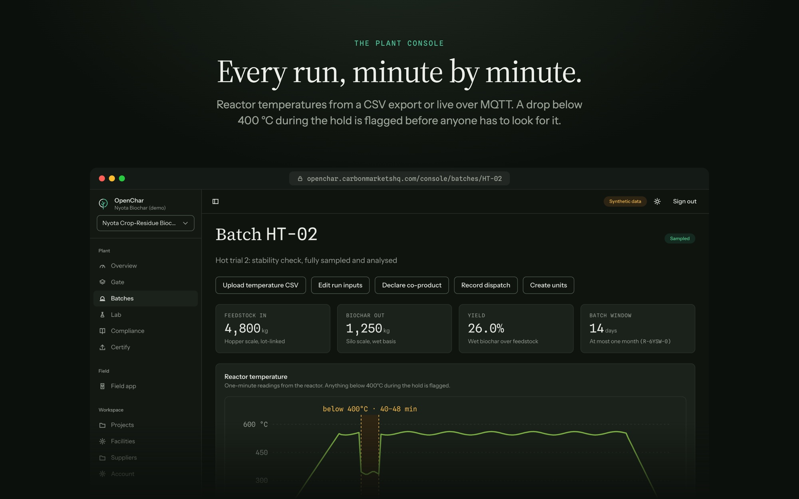
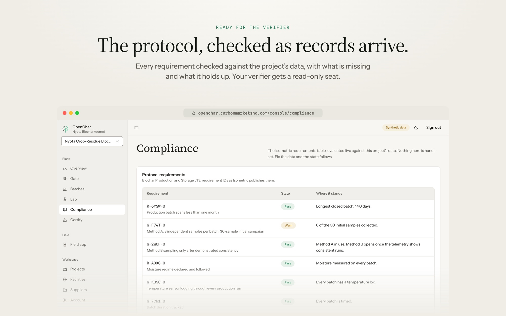

<p align="center">
  
</p>

<p align="center">
  <a href="https://openchar.carbonmarketshq.com">Hosted version</a> ·
  <a href="docs/self-hosting.md">Self-host</a> ·
  <a href="docs/architecture.md">How it works</a> ·
  <a href="docs/roadmap.md">Roadmap</a> ·
  <a href="LICENSE">AGPL-3.0</a>
</p>

OpenChar records what happens at a biochar plant, from feedstock arriving at
the gate to biochar going into the soil, and turns those records into the
evidence a carbon registry and an independent verifier ask for. Producers can
run this digital monitoring, reporting and verification (dMRV) software on
their own server, read every line of the carbon calculation, and keep a full
copy of their data.

<table>
  <tr>
    <td width="50%"></td>
    <td width="50%"></td>
  </tr>
  <tr>
    <td width="50%"></td>
    <td width="50%"></td>
  </tr>
</table>

## What it does

### Plant operations and custody

- **Field app:** an offline phone app for the point where feedstock is
  collected. Staff record suppliers, consignments, moisture, GPS position and
  photos in a tamper-evident log that syncs when there is signal. It installs
  from the phone's browser, with no app store.
- **Plant console:** checks feedstock lots against weighbridge slips, follows
  each production batch from the start of a run to lab sampling, and records
  co-products, energy use, transport, dispatches and soil applications.
  Reactor temperatures come from a CSV export or stream in live over MQTT
  (the messaging protocol most plant sensors and gateways speak).
- **Units and custody:** gives every bag or silo lot a QR code and its own
  chain of custody, through splits and merges, down to the farm.
- **Lab:** tracks samples and certificates, and checks the H/Corg and O/Corg
  ratios (the hydrogen-to-carbon and oxygen-to-carbon limits registries use
  for biochar stability) automatically.

### Carbon accounting and verification

- **Open carbon ledger:** calculates removals under Isometric's Biochar
  Production and Storage protocol v1.3, in open code that cites the
  protocol's own requirement IDs. Every line of a result names the records
  it used, so a verifier can trace any tonne back to a scale reading or a
  lab certificate.
- **Compliance view:** checks the project's data against the protocol's
  requirements as records come in, and shows which requirement each gap
  holds up.
- **Evidence vault:** fingerprints every uploaded file (SHA-256) and chains
  the field app's event log, each entry carrying the hash of the one before
  it, so a record changed after the fact can be detected.
- **Registry connector:** maps batches to Isometric Certify objects and
  exports sensor data in the registry's Parquet format. Without credentials
  it shows the exact payload it would send. With your Isometric API keys it
  submits.

### Access and sharing

- **Team and audit:** workspaces, admin and member roles, invitations by
  link, a sign-in audit trail, and a read-only account for your verifier.
- **Public page:** a summary of a project for buyers, shown only if you
  publish it.

## Status

OpenChar runs in production at
[openchar.carbonmarketshq.com](https://openchar.carbonmarketshq.com). No
credits have been issued through it yet. The ledger implements the Isometric
protocol today, and other registries' rules come next. The
[roadmap](docs/roadmap.md) lists what is being built.

## Why it is open

Most biochar producers in the Global South pay a software vendor to hold
their production data and calculate their carbon removal. The calculation is
closed, the data stays on the vendor's servers, and the fee is charged on
every tonne. For a small plant, that cost can decide whether certification
is worth attempting.

OpenChar is built as a public good. The code is free under the AGPL-3.0
licence. Because the carbon calculation is open, a producer, a buyer or a
verifier can check every number. And the producer stays in control:

- Run OpenChar on your own server, or use the hosted version and take a full
  copy of your data whenever you want.
- Nothing about a project is public until you publish it.
- Deal with the registry directly, and choose where to register and where to
  sell.

## Try it

### Hosted

Sign up at [openchar.carbonmarketshq.com](https://openchar.carbonmarketshq.com).
CarbonMarketsHQ runs the servers, backups and updates.

### On your own machine or server

You need Docker.

```bash
git clone https://github.com/CarbonMarketsHQ/openchar.git
cd openchar
cp .env.example .env
```

Edit `.env` and set `API_TOKEN` and `POSTGRES_PASSWORD` to long random
strings (`openssl rand -hex 24` makes one). Then start it:

```bash
docker compose up -d
```

Open http://localhost:3000. The first person to sign up sets up the server
and becomes its admin, and invites everyone else from the Account page. On a
remote server, set up HTTPS first as described in
[docs/self-hosting.md](docs/self-hosting.md#https).

To look around with sample data instead, run this before anyone signs up,
then sign in as `demo@openchar.example` with the password
`charcoal-demo-2026`:

```bash
docker compose exec api npm run seed
```

[docs/self-hosting.md](docs/self-hosting.md) covers HTTPS, email, backups and
upgrades.

## Develop

You need Node.js 22 and Docker. Run the API and the web app in two terminals.

```bash
npm install
docker compose up -d db
npm run seed          # sample data; refuses a database that already has workspaces
npm run dev:server    # API on port 8080
npm run dev:web       # web app on port 3000
```

`npm run evals` runs the automated checks: 20 ledger and configuration tests,
then 51 browser tests against a production build. It starts its own servers
and resets the development database to the sample data.
A change is done when they pass, and [evals/CHARTER.md](evals/CHARTER.md)
says what each one proves.

## Contributing

Issues and pull requests are welcome. Read [CONTRIBUTING.md](CONTRIBUTING.md)
first, and report security problems privately as described in
[SECURITY.md](SECURITY.md).

## Licence

[AGPL-3.0](LICENSE). You can use, change and share OpenChar freely. If you
run a changed version as a service for other people, you must offer them its
source code under the same licence. The CarbonMarketsHQ name and logo are not
covered by the licence, so a modified copy offered to others should carry its
own name and logo.

Built and maintained by [CarbonMarketsHQ](https://carbonmarketshq.com).
